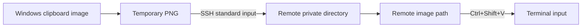

# SSH Image Paste

[中文使用说明](README.zh-CN.md)

Press **Ctrl+Alt+V** in Windows Terminal to upload a clipboard image to a Linux SSH host and paste its remote path. Useful for Codex CLI and other tools that can read image files on the remote host.

No remote clipboard, X11 forwarding, Python, Node.js, or remote agent is required. This is a standalone Windows helper, not a Codex extension.

## How it works



The helper opens a **separate SSH connection to the configured destination**. It does not detect or reuse the SSH session in your terminal. Make sure both point to the same host and user. A container may not share the host's `/tmp` filesystem.

## Requirements

- Windows 10/11, Windows Terminal, and Windows PowerShell 5.1 with .NET Framework.
- Windows OpenSSH Client at `%WINDIR%\System32\OpenSSH\ssh.exe`.
- Windows Script Host for the silent `Start.vbs` launcher; a direct PowerShell launch is also available below.
- A Linux SSH host with a POSIX shell, `mktemp`, `cat`, and writable `/tmp`.
- SSH authentication that works without prompting, using a key or an SSH agent. Establish and verify the host's identity with a normal SSH connection first.
- Windows Terminal's **Ctrl+Shift+V** binding must perform paste. Run the helper and terminal at the same privilege level, normally without administrator rights.

## Quick start

Download this repository or clone it, keep it in a permanent writable folder, and open a **local Windows PowerShell** there. Do not run these setup commands inside the remote SSH session.

1. Configure an SSH alias in `%USERPROFILE%\.ssh\config` (or use `user@hostname` directly):

   ```sshconfig
   Host my-server
       HostName server.example.com
       User your-user
       IdentityFile ~/.ssh/id_ed25519
       # Port 2222
       # ProxyJump bastion
   ```

2. Connect normally, verify the host key, and then check noninteractive access:

   ```powershell
   ssh my-server
   # Exit the remote session, then run locally:
   ssh -T -o BatchMode=yes -o StrictHostKeyChecking=yes my-server "printf ready"
   ```

3. Install the login startup shortcut and start the helper:

   ```powershell
   powershell.exe -NoProfile -ExecutionPolicy Bypass -File .\Install.ps1 -Destination my-server
   ```

   `-ExecutionPolicy Bypass` applies to that process; it does not change your machine's policy. Organizational policies may still prevent execution. The installer points the shortcut at this folder; do not move it after installation.

4. Copy an image or take a screenshot with **Win+Shift+S**. Select the remote tool's input in **Windows Terminal**, press **Ctrl+Alt+V**, and release the keys. Keep the tab and pane selected while uploading.

5. A path such as `/tmp/codex-clipboard.Abc1234567/image.png` is pasted. Add your request and press Enter yourself:

   ```text
   Please analyze /tmp/codex-clipboard.Abc1234567/image.png
   ```

The tool receives a path, not an inline image attachment or thumbnail. It must have access to that file and support reading images.

## Configuration and lifecycle

`config.json` is local and ignored by Git. The committed `config.example.json` shows its format. The destination accepts an SSH alias, hostname, or `user@hostname`. Configure ports, keys, IPv6 literals, and jump hosts through your SSH config, not shell flags in the destination.

Change the destination, stop the helper, and start it again:

```powershell
powershell.exe -NoProfile -ExecutionPolicy Bypass -File .\Configure.ps1 -Destination other-server
powershell.exe -NoProfile -ExecutionPolicy Bypass -File .\Stop.ps1
# Wait for the tray icon to disappear before restarting.
wscript.exe .\Start.vbs
```

Only one instance per Windows user/session runs. The destination is loaded at startup. To use the helper without login startup, run `Configure.ps1`, then double-click `Start.vbs`.

If Windows Script Host is unavailable, run the following and keep that PowerShell process open:

```powershell
powershell.exe -NoProfile -STA -ExecutionPolicy Bypass -File .\Bridge.ps1
```

To stop it, right-click the tray icon and choose **Exit image paste helper**, or run `Stop.ps1`. To remove login startup and request shutdown:

```powershell
powershell.exe -NoProfile -ExecutionPolicy Bypass -File .\Uninstall.ps1
```

Uninstall leaves source files, configuration, logs, and remote images intact. `Install.ps1 -NoStart` installs startup without launching the helper. Stop and uninstall any older copy before switching to this version, because both use Ctrl+Alt+V.

## Troubleshooting

| Symptom | What to check |
| --- | --- |
| Remote tool reports `clipboard unavailable` or an X11 error | The remote clipboard operation ran. Check that the local helper is running, use Windows Terminal, and confirm the hotkey is available. |
| Nothing happens | Copy actual image content, not just a file in Explorer. Check the tray icon, `bridge.log`, the foreground terminal, and privilege levels. |
| Hotkey already in use | Exit another copy or application using Ctrl+Alt+V. |
| SSH authentication or host key error | Run the noninteractive SSH check above. Unlock the key through your SSH agent if needed. The helper does not prompt for passwords or approve new host keys. |
| Path was copied but not pasted | The foreground window/title changed or modifier keys stayed pressed. Return to the intended input and press Ctrl+Shift+V. |
| Remote tool cannot find the image | Confirm the configured host and user match the terminal session. Check container filesystem boundaries and `/tmp` cleanup. |
| Configuration changed but uploads go to the previous host | Restart the helper. |

`state.json` records the process ID and destination; it can remain stale after an abnormal exit. `bridge.log` records startup, upload paths, and errors, but not image contents. A `PASTED` entry means Windows accepted the synthetic keystrokes; it cannot prove the remote tool attached or read the image.

## Privacy and limits

- Clipboard content is read and sent only after you press the hotkey in Windows Terminal. The helper checks the terminal process, not which remote application or shell prompt is active. Trigger it only at the intended input.
- Uploads use your existing SSH configuration with strict host-key checks and noninteractive authentication. No credential is stored in this repository.
- Each remote image gets a random directory (mode `700`) and file (mode `600`). Local temporary images are removed after the attempt. Remote images remain until host cleanup or manual removal.
- After success, the clipboard holds the remote path. If clipboard content changes during upload, the helper keeps the newer content and writes the uploaded path to the log.
- Window/title checks reduce accidental paste but cannot reliably distinguish all tabs and split panes. Keep the intended pane focused; the helper never presses Enter.
- Only Windows Terminal is supported. This helper has not been adapted to PuTTY, VS Code terminals, macOS, or Linux desktops. The hard-coded hotkey is Ctrl+Alt+V.
- The upload runs on the helper's UI thread. Tray controls may pause during a transfer. SSH connection and keepalive limits are configured, but the current process-exit timeout is not a strict end-to-end upload deadline.

## Tests

Run offline validation and native compilation (no clipboard access, remote upload, or hotkey registration):

```powershell
powershell.exe -NoProfile -ExecutionPolicy Bypass -File .\Test-Config.ps1
powershell.exe -NoProfile -ExecutionPolicy Bypass -File .\Test-Bridge.ps1
powershell.exe -NoProfile -STA -ExecutionPolicy Bypass -File .\Bridge.ps1 -Check
```

After stopping the helper, `Bridge.ps1 -CheckHotkey` briefly registers and releases the hotkey. For a real transfer check after configuration:

```powershell
powershell.exe -NoProfile -ExecutionPolicy Bypass -File .\Test-Transfer.ps1
```

This creates its own 8×8 PNG, uploads it, checks SHA-256 and permissions, then removes the test image and directory. It never reads your clipboard. The remote check additionally requires `sha256sum`, GNU-compatible `stat -c`, `rm`, and `rmdir`.

## Source tour

| File | Responsibility |
| --- | --- |
| `Bridge.ps1` | Tray application, clipboard handling, upload/paste orchestration |
| `Bridge.Native.cs` | Windows hotkey registration, foreground checks, simulated paste |
| `Bridge.Core.ps1` | Configuration validation, argument quoting, SSH byte transfer, path validation |
| `Configure.ps1` | Write a local destination configuration |
| `Install.ps1`, `Uninstall.ps1` | Manage this installation's login shortcut |
| `Start.vbs`, `Stop.ps1` | Launch silently / request shutdown |

`Add-Type` compiles the small C# helper at runtime; no separate build tool is needed. The PNG travels through SSH's binary stdin stream to remote `cat`, and a validated `CODEX_IMAGE_PATH=` marker brings the result back.

## License

MIT. See [LICENSE](LICENSE).
